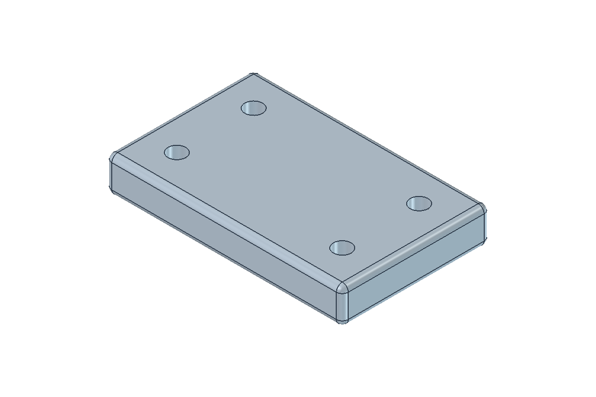

# FluxCAD

**A compact Windows workspace for FreeCAD, with a ribbon and modeling workflows inspired by Fusion.**

[日本語](README.md) · [User guide](docs/User-guide-en.md) · [Changelog](CHANGELOG.md)

**0.1.0-alpha** is an initial preview for testing and feedback. FluxCAD is an independent project, not an official product of Autodesk or the FreeCAD project. FreeCAD must be installed separately.



## Start

1. Install [FreeCAD](https://www.freecad.org/downloads.php). **Windows with FreeCAD 1.1.3** is the tested environment. Other versions, macOS and Linux are unverified.
2. Download `FluxCAD-v0.1.0-alpha-windows.zip` from [Releases](https://github.com/victriokook/fluxcad/releases) and extract it to a writable folder. A source checkout can be launched in the same way.
3. Double-click **`Start-FluxCAD.cmd`**. It finds an installed FreeCAD and starts it with separate settings.
4. The initial language is Japanese. Select **設定 → 表示言語 / Language → English**, save your work and restart.
5. Open **`samples/Sample.FCStd`** to try a plate with holes.

To select a different FreeCAD installation:

```powershell
.\Start-FluxCAD.ps1 -FreeCADPath "C:\path\to\FreeCAD\bin\FreeCAD.exe"
```

FreeCAD supplies Python, OpenCASCADE and Qt. No separate Python installation is required to run FluxCAD. FreeCAD binaries and portable distributions are not bundled.

## Features

- Japanese/English ribbon, bodies/sketches/meshes browser and movable panels.
- Sketches, grid snapping, and selection/extrusion of bounded regions formed by crossing lines, arcs and B-splines.
- Extrude, revolve, loft, sweep, holes/threads, fillets, chamfers, shells, draft and Boolean operations.
- Move, rotate, align, mirror, rectangular/circular/path patterns, construction planes and axes.
- STL selection, movement, scaling, rotation, separation and plane cuts.
- Basic components/joints, native FreeCAD surface tools and TechDraw drawing/PDF/SVG workflows.

See the [user guide](docs/User-guide-en.md) for supported cases and feature limitations.

## Controls

| Action | Input |
| --- | --- |
| Pan | Middle-button drag |
| Orbit | Shift + middle-button drag, or drag the view cube |
| Zoom | Mouse wheel |
| Extrude | Finish Sketch → click inside a region → E |
| Add/remove selection | Ctrl + click |
| Move selected body | M |
| Command search | S |
| Fixed grid | Palette 0.1 / 0.5 / 1 mm presets, or enter a value and press Enter |

## Saving and limitations

Use FCStd to retain editable models. Start FluxCAD before opening documents with FluxCAD-specific linked features. STEP/STL exports do not retain feature history or joints. Region selection is available after finishing sketch edit; topology changes may require reselecting regions.

Advanced assembly constraints, sheet metal, CAM and simulation are not provided. FluxCAD is not fully compatible with Fusion and does not directly import Fusion design files. Settings are stored in the extracted folder's `config/` directory. Extract updates to a separate folder, save documents and close the old version before using the new one. Test important designs on copies.

## Feedback and development

Use **Bug report / 不具合報告** in Issues with versions, steps to reproduce and the expected result. Small non-confidential example files help.

[Validation](docs/VALIDATION.md) · [Contributing](CONTRIBUTING.md) · [Publishing instructions](docs/PUBLISHING.md)

FluxCAD's original code, bundled original icons and samples use the [MIT License](LICENSE). FreeCAD and its dependencies retain their own licenses; see [third-party notices](THIRD_PARTY_NOTICES.md).
