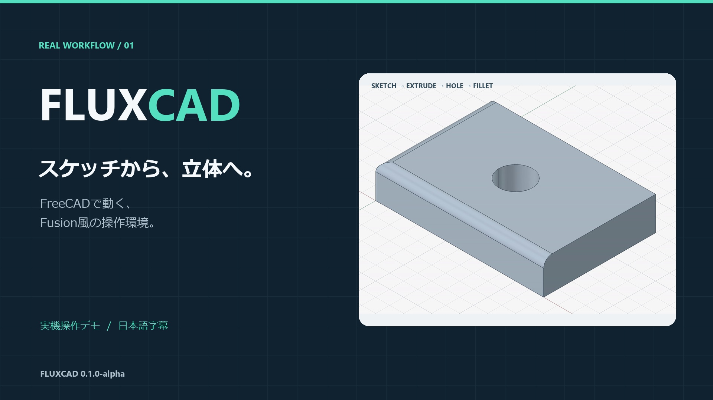

# FluxCAD

**FreeCADに、コンパクトなリボンとFusionを参考にしたモデリング操作を追加するWindows向けワークスペースです。**

[English](README-en.md) · [詳しい使い方](docs/User-guide-ja.md) · [変更履歴](CHANGELOG.md)

現在のバージョンは **0.1.0-alpha**。試用・フィードバック向けの初回公開版です。FreeCAD本体を別途使用する独立したプロジェクトで、AutodeskやFreeCADプロジェクトの公式製品ではありません。

## 59秒の操作デモ

[](https://www.youtube.com/watch?v=TVqF2vXXdVI)

**[YouTubeで操作デモを見る（59秒・日本語字幕）](https://www.youtube.com/watch?v=TVqF2vXXdVI)**

長方形スケッチから、領域の選択・押し出し・穴・フィレット・ビューキューブでの回転まで、実際の操作を紹介しています。

## はじめる

1. [FreeCAD](https://www.freecad.org/downloads.php)をインストールします。動作検証は **Windows／FreeCAD 1.1.3** で行っています。他のバージョン、macOS、Linuxは未検証です。
2. [Releases](https://github.com/victriokook/fluxcad/releases)にある `FluxCAD-v0.1.0-alpha-windows.zip` をダウンロードし、書き込み可能なフォルダに展開します。ソースをダウンロードした場合も同じ手順で起動できます。
3. **`Start-FluxCAD.cmd` をダブルクリック**します。インストール済みFreeCADを検出し、専用設定で起動します。
4. **ファイル → 開く**で `samples/Sample.FCStd` を開くと、穴のあるプレートを試せます。

別のFreeCADを指定する場合は、PowerShellから実行します。

```powershell
.\Start-FluxCAD.ps1 -FreeCADPath "C:\path\to\FreeCAD\bin\FreeCAD.exe"
```

FreeCADがPython、OpenCASCADE、Qtなどの実行環境を提供します。追加のPythonインストールは不要です。FreeCAD本体やポータブル版はこの配布物に含めていません。

## できること

- 日本語・英語のリボン、ボディ／スケッチ／メッシュのブラウザー、移動可能な操作パネル。
- スケッチ、グリッドスナップ、交差する線・円弧・スプラインで囲んだ領域の選択と押し出し。
- 押し出し、回転、ロフト、スイープ、穴・ねじ、フィレット、面取り、シェル、勾配、ブーリアン演算。
- ボディ移動・回転・整列、ミラー、矩形／円形／経路パターン、構築面と軸。
- STLメッシュの選択・移動・拡縮・回転・分離・平面カット。
- 基本的なコンポーネントとジョイント、ネイティブのサーフェス機能、TechDrawによる図面・PDF/SVG出力。

各機能の条件と制限は[操作ガイド](docs/User-guide-ja.md)に記載しています。

## 基本操作

| 操作 | 入力 |
| --- | --- |
| パン | 中ボタンを押してドラッグ |
| 回転 | Shift＋中ボタンドラッグ、または右上キューブをドラッグ |
| ズーム | マウスホイール |
| 押し出し | スケッチ終了 → 領域内をクリック → E |
| 複数選択 | Ctrl＋クリック |
| 移動 | ボディを選択 → M |
| コマンド検索 | S |
| 固定グリッド | パレットの0.1／0.5／1 mmボタン、または数値入力＋Enter |

英語へ切り替えるには **設定 → 表示言語 / Language → English** を選び、作業を保存して再起動します。

## 保存と既知の制限

- 編集用にはFCStdを使います。FluxCAD独自の関連付けを持つ部品は、FluxCADを起動してから開いてください。STEP/STLでは編集履歴やジョイントを保持しません。
- スケッチの領域選択は編集終了後に使用します。輪郭や交点の数が変わる編集では、領域を選び直す必要がある場合があります。
- 高度なアセンブリ拘束、板金、CAM、シミュレーションは提供していません。Fusionと完全互換ではなく、Fusionの設計ファイルを直接読み込む機能はありません。
- 設定は展開先の `config/` に保存します。更新時は別フォルダへ展開し、文書を保存してから旧版を終了してください。重要な設計はコピーで試してください。

## 不具合報告・開発

[Issues](https://github.com/victriokook/fluxcad/issues)の **Bug report / 不具合報告** から、バージョン、再現手順、期待した結果を記入してください。可能なら個人情報や機密情報を含まない小さな再現用モデルを添付してください。

[検証内容](docs/VALIDATION.md) · [開発への参加](CONTRIBUTING.md) · [公開手順](docs/PUBLISHING.md)

## ライセンス

FluxCAD独自コード・同梱の独自アイコン・サンプルは[MIT License](LICENSE)で提供します。FreeCADとその依存ライブラリのライセンスは別です。[第三者ソフトウェアについて](THIRD_PARTY_NOTICES.md)を参照してください。
